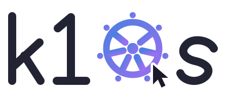
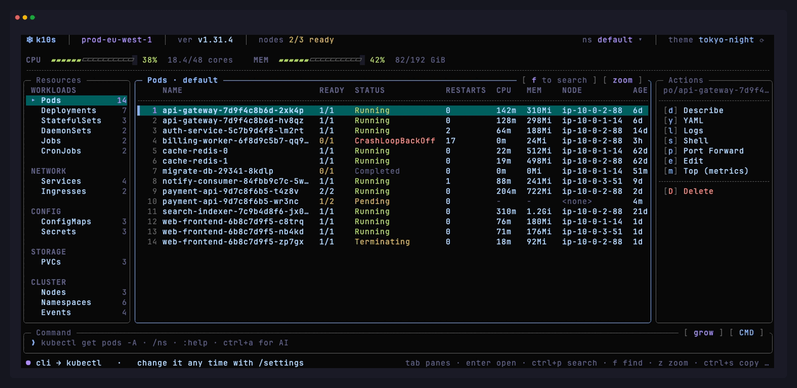

<div align="center">

<picture>
  <source media="(prefers-color-scheme: dark)" srcset="assets/logo/wordmark-on-dark.svg">
  
</picture>

### The Kubernetes terminal UI you can *click*.

A k9s-style terminal UI where the mouse works, one search box covers the
whole cluster, and themes are built in. Single static binary, updates itself.

[](docs/roadmap.md)
[](go.mod)
[](#install)
[](#install)
[](docs/update.md)
[](LICENSE)
[](#contributing)

[Install](#install) · [Try it without a cluster](#try-it-without-a-cluster) ·
[Features](#features) · [k9s → k10s](#coming-from-k9s) · [Docs](docs/README.md)

</div>

---

## Install

macOS and Linux, `amd64` and `arm64`:

```bash
curl -fsSL https://p10node.com/k10s/install.sh | sh
```

The script picks the right binary, checks its sha256 against the release
manifest, and puts it in `/usr/local/bin` (or `~/.local/bin` when sudo is not
an option). Flags, uninstall, and how to verify a release's build provenance
are in [docs/install.md](docs/install.md).

Other ways:

```bash
go install github.com/p10node/k10s@latest    # with Go on the box

git clone https://github.com/p10node/k10s && cd k10s
just install                                 # from source, version-stamped
```

Windows: download `windows/amd64` from the
[release page](https://github.com/p10node/k10s/releases).

Upgrade later with `k10s update`. It replaces the running binary in place,
checksum-verified ([docs/update.md](docs/update.md)).

Run it:

```bash
k10s                  # your current kubeconfig context
k10s demo             # built-in sample cluster, no cluster needed
k10s --readonly       # never changes anything in the cluster
k10s --version
```

<div align="center">



<sub>`k10s demo`, captured from a real terminal with `just screenshot`.</sub>

</div>

## Try it without a cluster

`k10s demo` opens an offline sample cluster, CrashLoopBackOff included. It is
a normal context: `/demo` switches to it, `:ctx` lists it as
`k10s demo · sample data`, and picking any other context leaves it. The
header shows `DEMO` the whole time so it cannot be mistaken for a real
cluster.

Plain `k10s` reads the same kubeconfig as `kubectl`. If nothing answers, the
main panel says **No cluster**: `r` retries, `:ctx` picks another context,
`/setup` has the links. Longer version in
[docs/cluster-setup.md](docs/cluster-setup.md).

## Why k10s

- **Actions are on screen.** What you can do with the selected object is
  listed in its own pane. Click it or press the key next to it.
- **The mouse works.** Rows, panes, `[ zoom ]`, `ns default ▾`, scrolling.
- **One search box.** `ctrl+p` searches kinds and objects together.
- **Opens instantly.** No watches at startup. Each kind starts its informer
  the first time you open it ([docs/performance.md](docs/performance.md)).
- **k9s plugins work.** Drop a `plugins.yaml` in `~/.k10s/`
  ([docs/plugins.md](docs/plugins.md)).
- **AI is off in this build.** `ctrl+a` says so instead of sending anything.

## Features

### Resources

30 kinds in seven groups: Workloads, Network, Config, Storage, RBAC, Cluster,
Custom Resources. CRDs are discovered automatically. Groups fold with `space`
or a click, stay folded across restarts, and a folded group costs no
requests.

### Actions

| Key             | Action                                      |
|-----------------|---------------------------------------------|
| `d` / `y`       | describe / live YAML                        |
| `l`             | logs, following, 500 lines of scrollback    |
| `s`             | interactive shell, in the pane              |
| `p`             | port-forward, start and stop from the pane  |
| `m`             | pod and node metrics, requests vs limits    |
| `e` / `r` / `c` | edit in `$EDITOR` / rollout restart / scale |
| `o` / `u`       | cordon-uncordon / drain, Nodes only         |
| `D`             | delete, behind a confirm modal              |

Your own actions go in `~/.k10s/plugins.yaml`, k9s format. They show up in
the same pane and are clickable too. See [docs/plugins.md](docs/plugins.md).

### Themes

Eight built in: `tokyo-night` (default), `catppuccin-mocha`, `dracula`,
`nord`, `gruvbox-dark`, `solarized-dark`, `solarized-light`, `matrix`.
`T` cycles. `/theme` applies each one live as you move through the list.
Custom palettes go in `~/.k10s/themes` as YAML, no rebuild needed. See
[docs/themes.md](docs/themes.md).

### Small things

- `ctrl+s` copy mode releases the mouse so your terminal can select text.
- A real loading state while a watch syncs, not "no resources found".
- Namespace and context pickers. You never type a name.
- No setup screen. Every setting has a default, `/settings` is there when
  you want it.
- `ctrl+z` grows the prompt for long commands.
- A "terminal too small" notice instead of a broken layout.

### AI

The AI prompt is disabled in this build. `ctrl+a` shows a notice. The
provider code (OpenAI-compatible, Anthropic) is still in the tree but the UI
does not call it. Do not configure an API key.

## Coming from k9s

k10s exists because of [k9s](https://github.com/derailed/k9s), and is
deliberately smaller. The difference is the input model:

|           | k9s                          | k10s                                       |
|-----------|------------------------------|--------------------------------------------|
| Input     | keyboard, command-driven     | mouse and keyboard, equally                |
| Discovery | you learn the commands       | actions for the selected object are listed |
| Search    | per-view filter, `:` to jump | one box (`ctrl+p`) over kinds and objects  |
| Scope     | very large, plugin ecosystem | small, k9s command plugins supported       |
| Upgrades  | your package manager         | `k10s update`                              |

Use k9s for the biggest feature surface and years of production mileage. Use
k10s when you want to hand a TUI to someone who has never opened one.

## Keys

| Key                    | Action                                   |
|------------------------|------------------------------------------|
| `tab` / `shift+tab`    | cycle panes                              |
| `↑↓` `j`/`k` `g`/`G`   | move, first/last                         |
| `f`                    | find in the open table                   |
| `ctrl+p`               | search everything                        |
| `enter` / double-click | open: logs if it has them, else describe |
| `z`                    | zoom the centre pane                     |
| `:` / `/`              | command prompt                           |
| `T`                    | cycle themes                             |
| `ctrl+s`               | copy mode                                |
| `q` / `ctrl+c`         | quit                                     |

Full list in [docs/keybindings.md](docs/keybindings.md).

## Commands

`/` is k10s itself. `:` is the cluster, in k9s vocabulary. Anything else runs
in your `$SHELL` and its output opens in the main panel.

```
/theme  /settings  /mouse  /update  /version  /demo  /setup  /help

:po  :deploy  :svc  :cm  :pvc  :sa  :no  :ns  :ev  :crd ...   resource views
:po kube-system                                             that kind, in that namespace
:ns   :ctx                                                  pickers
:ns <name>   :ctx <name>                                    switch directly
:aliases                                                    every `:` command
```

Full list in [docs/commands.md](docs/commands.md).

## Config

k10s opens on kubeconfig's current context. `:ctx` switches for the session
only. Theme, namespace, folded groups, and the update check are saved to
`~/.k10s/config.yaml` (`K10S_CONFIG` overrides the path). See
[docs/config.md](docs/config.md).

## Docs

| File                                      | Contents                                      |
|-------------------------------------------|-----------------------------------------------|
| [architecture.md](docs/architecture.md)   | packages, `Source` boundary, render pipeline  |
| [performance.md](docs/performance.md)     | lazy watches, cheap counts, regression guards |
| [ui.md](docs/ui.md)                       | layout, panes, focus, zoom, overlays          |
| [keybindings.md](docs/keybindings.md)     | full key and mouse reference                  |
| [commands.md](docs/commands.md)           | prompt modes, slash commands                  |
| [plugins.md](docs/plugins.md)             | k9s-compatible command plugins                |
| [themes.md](docs/themes.md)               | theme list, picker, custom palettes           |
| [config.md](docs/config.md)               | what persists and when                        |
| [install.md](docs/install.md)             | installer flags, verification, uninstall      |
| [update.md](docs/update.md)               | how self-update works                         |
| [cluster-setup.md](docs/cluster-setup.md) | installing kubectl, getting a kubeconfig      |
| [backends.md](docs/backends.md)           | live backend vs demo                          |
| [dev.md](docs/dev.md)                     | build, tests, headless renderer               |
| [maintaining.md](docs/maintaining.md)     | PRs, CI, releases                             |
| [roadmap.md](docs/roadmap.md)             | done, missing, known limits                   |

## Contributing

```bash
just dev            # run from source
just shot 140 44    # render one frame headlessly, no TTY, no cluster
just check          # fmt + vet + test
```

`cmd/shot` renders frames without a terminal or a cluster, so UI work is
quick to iterate and diff. Build and test notes are in
[docs/dev.md](docs/dev.md), the maintainer side in
[docs/maintaining.md](docs/maintaining.md), and things to pick up in
[roadmap.md](docs/roadmap.md#possible-next-steps).

**Status:** every live path is implemented against client-go and covered by
tests with fake clientsets, but the author has not yet smoke-tested it on a
production cluster. Try it on `kind` first. Known limits are in
[the roadmap](docs/roadmap.md#known-limits).

## Contributors

| Who                                                | What                  |
|----------------------------------------------------|-----------------------|
| [@pierreneter](https://github.com/pierreneter)     | author and maintainer |
| [@junior](https://github.com/junior)               | maintainer            |
| [@clamshell2000](https://github.com/clamshell2000) | contributor/observer  |

Pull requests welcome. See [docs/maintaining.md](docs/maintaining.md) for how
they are reviewed and released.

## Thanks

To my colleagues. k10s was built so that looking at our clusters stops being
the annoying part of the day. Every pane is an answer to something one of you
asked. Thank you for the inspiration, the patience, and for being the first
users.

> *Cảm ơn các đồng nghiệp của tôi - repo này được viết ra để phục vụ các bạn,
> và chính các bạn là nguồn cảm hứng cho k10s.*

To [@derailed](https://github.com/derailed) and k9s, for proving a Kubernetes
TUI could be something you actually want to open.

To [Charm](https://github.com/charmbracelet) (Bubble Tea, Lip Gloss, Bubbles)
and [BubbleZone](https://github.com/lrstanley/bubblezone), which is why
anything here is clickable.

## License

[Apache-2.0](LICENSE). Same license as Kubernetes, Helm and k9s.
